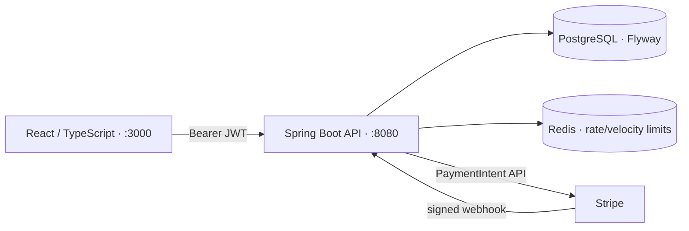

# PeerVault

PeerVault is a wallet and peer-to-peer transfer application built from the existing payment-engine codebase. It includes a Java 17/Spring Boot API, PostgreSQL persistence, Redis-backed rate and velocity limits, a React/TypeScript client, and an optional Stripe funding integration.

## Run locally

Requirements: Docker Compose. Stripe credentials are optional; without them, wallet registration and transfers work, but funding is disabled.

```bash
cp .env.example .env
# Replace DB_PASSWORD, PEERVAULT_JWT_SECRET (at least 32 random bytes),
# and COREISSUER_PEPPER with unique values. To enable the admin API,
# set both PEERVAULT_ADMIN_EMAIL and PEERVAULT_ADMIN_PASSWORD.
docker compose up --build
```

Open the app at [http://localhost:3000](http://localhost:3000). The API and interactive OpenAPI page are available at [http://localhost:8080](http://localhost:8080) and [http://localhost:8080/swagger-ui.html](http://localhost:8080/swagger-ui.html). PostgreSQL and Redis are bound to loopback only.

To accept wallet funding, configure `STRIPE_SECRET_KEY`, `STRIPE_WEBHOOK_SECRET`, and `STRIPE_PUBLISHABLE_KEY`. Configure Stripe to send `payment_intent.succeeded`, `payment_intent.payment_failed`, and `payment_intent.canceled` events to `POST /api/payments/stripe/webhook`. Credits are posted only after signature, amount, and currency verification.

## Components



- `common` contains JPA entities and repositories.
- `core-api` implements registration, authentication, wallets, transfers, payment intents, webhook processing, fraud review, and reconciliation.
- `frontend` contains the responsive PeerVault web application.
- `admin-struts` is a legacy Struts application retained as source only. It is not part of the active Maven reactor or Compose deployment and must not be used as an admin interface.

## Money movement and consistency

- Amounts are represented as decimal strings at API boundaries and stored as `NUMERIC(19,4)`. Frontend aggregation uses integer units rather than floating-point arithmetic.
- Transfers lock sender and recipient wallets in deterministic ID order, then debit and credit the cached balances and append one ledger posting per wallet in a single database transaction.
- PostgreSQL prevents ledger updates/deletes and defers a database constraint that requires every completed transfer to have exactly one matching debit and credit. Terminal transfer records are immutable.
- Transfer retries use a durable, user-scoped idempotency key and request hash. A repeated key with a different request returns a conflict.
- Reconciliation compares wallet cached balances to the ledger and checks completed transfers for exact, balanced postings.
- Stripe events are deduplicated by provider event ID. The webhook signature is time-bounded, and a successful event must match the stored intent amount and currency before crediting the wallet.

## API overview

| Method | Path | Purpose |
| --- | --- | --- |
| `POST` | `/api/auth/register` | Register a user and create supported-currency wallets |
| `POST` | `/api/auth/login` | Authenticate and receive a short-lived bearer token |
| `GET` | `/api/users/me` | Read the authenticated profile |
| `GET` | `/api/wallet` | Read the user's default wallet |
| `GET` | `/api/wallet/transactions` | List wallet ledger activity |
| `POST` | `/api/transfers` | Send money; requires `Idempotency-Key` |
| `GET` | `/api/transfers` | List the authenticated user's transfers |
| `POST` | `/api/wallet/fund` | Create a Stripe PaymentIntent; requires `Idempotency-Key` |
| `POST` | `/api/payments/stripe/webhook` | Process signed Stripe events |
| `GET` | `/api/admin/reconciliation` | Compare balances and ledger; admin only |
| `GET`, `PATCH` | `/api/admin/fraud-flags` | Review risk flags; admin only |
| `GET` | `/api/admin/audit-logs` | Review audit events; admin only |

All wallet and transfer routes require a bearer token. Admin routes require an account configured with the `ADMIN` role. New public registrations cannot assign themselves privileged roles. The former `/api/v1/**` card-engine API is restricted to admins.

## Configuration

Copy `.env.example` to `.env` and set at least:

| Variable | Required | Notes |
| --- | --- | --- |
| `DB_PASSWORD` | Yes | PostgreSQL password |
| `PEERVAULT_JWT_SECRET` | Yes | At least 32 random UTF-8 bytes |
| `COREISSUER_PEPPER` | Yes | Separate secret retained for the legacy card API |
| `PEERVAULT_CORS_ALLOWED_ORIGINS` | No | Comma-separated browser origins; defaults to `http://localhost:3000` |
| `PEERVAULT_ADMIN_EMAIL`, `PEERVAULT_ADMIN_PASSWORD` | Optional pair | Creates/recognizes the admin account; password must be 12–72 UTF-8 bytes |
| `STRIPE_SECRET_KEY`, `STRIPE_WEBHOOK_SECRET`, `STRIPE_PUBLISHABLE_KEY` | Optional | Required only to enable end-to-end Stripe funding |

Other environment settings, including supported currencies, transfer ceilings, Redis address, and JWT lifetime, are documented by their defaults in `core-api/src/main/resources/application.yml`.

## Development and verification

```bash
./mvnw -B -pl core-api -am test
./mvnw -B verify                 # also runs PostgreSQL Testcontainers integration tests; requires Docker
cd frontend
npm ci
npm run lint
npm run build
```

Compose syntax can be checked without starting containers:

```bash
docker compose --env-file .env.example config --quiet
```

## Scope and deployment notes

This repository is a development-ready reference application, not a hosted payment service. Before production use, add operational controls appropriate to the deployment: secret management and rotation, TLS/ingress configuration, backups and restore drills, monitoring and alerting, abuse controls, and provider onboarding. Keep Stripe test/live credentials and webhook secrets out of source control. The legacy Struts application is excluded from active builds and deployment pending a separate security and compatibility upgrade.
